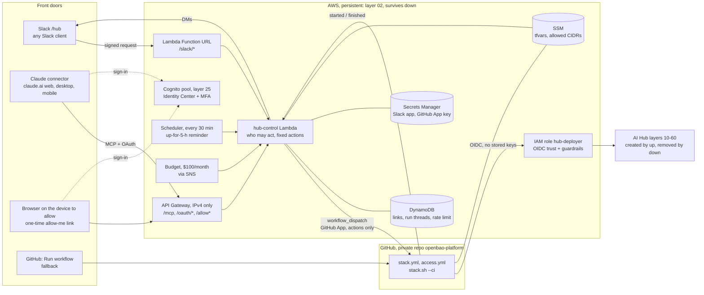
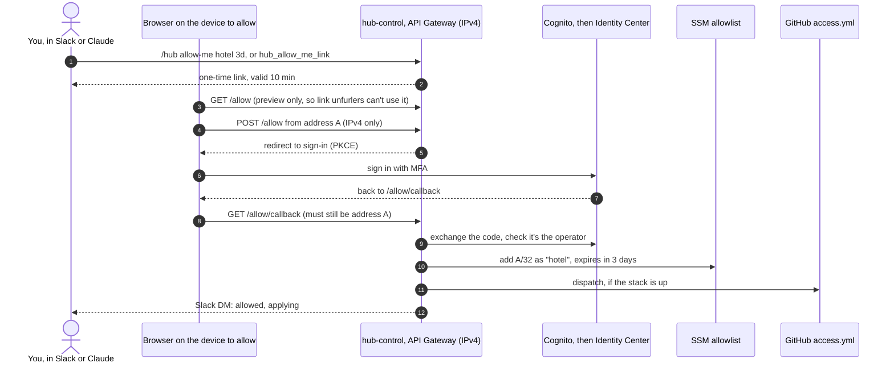
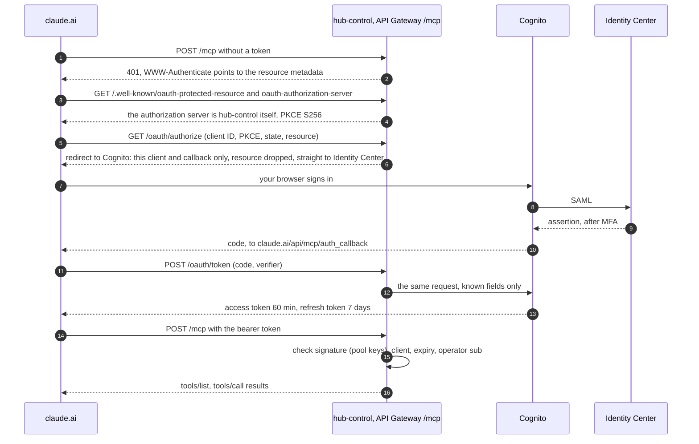

# Remote stack control: start, stop and open the AI Hub from anywhere

Status: **all five steps of §11 built 2026-11-24** (openbao-platform D-30 to D-34; workflows in openbao-platform). All five tested end to end (the Claude connector signed in from claude.ai the same day).

Today `scripts/stack.sh up|down` only runs on the laptop, after `aws sso login --profile
agentgrid`, and only from the two home IP addresses. This doc proposes a way to:

1. start, stop and check the stack from anywhere (phone, another computer),
2. change the IP allowlists from anywhere, so the hub itself is usable away from home,
3. wake the stack from **Slack** and from a **Claude agent**, and
4. do all of that with no long-lived AWS credentials stored anywhere, and with guardrails.

## Decisions (2026-11-24)

| # | Question | Decision |
|---|---|---|
| R-1 | Scope | Start/stop from anywhere **and** use the hub from anywhere |
| R-2 | Runner | **GitHub Actions** in **openbao-platform** itself, which turned out to be private (first planned in a separate private `hub-ops` repo, now archived) |
| R-3 | Front doors | **Slack** command and a **Claude** connector, both through one control Lambda |
| R-4 | Agent power | **Operator only**: start, stop, status, run logs, allowlist links. No arbitrary commands, no Terraform edits |
| R-5 | Schedule | **None.** Up and down are always intentional; no scheduled up, no automatic down |
| R-6 | Allowlist | **Kept** on the EKS API and the public URLs; /32s added and removed on demand from wherever you are |
| R-7 | Slack | The **same workspace** as the research-agent bridge |
| R-8 | GitHub plan | Free (2,000 private minutes/month, ≈25 up+down cycles) |
| R-9 | Bootstrap state | Moves to the state bucket, own key `openbao-platform/00-bootstrap.tfstate` |
| R-10 | Local tfvars | Move to SSM Parameter Store (SecureString) |
| R-11 | Unpushed commits | You push all openbao-platform commits before the first remote run |
| R-12 | OpenBao recovery keys | **None**: keep self-init (D-06/D-20); protect the KMS key and snapshots instead |
| R-13 | Cost reminder | One Slack reminder after the stack has been up **5 hours** |

On "openbao-platform is public because of Argo CD": it isn't public; it's **private**
(found on the first remote run, 2026-11-24). Argo CD reads only **ai-hub** (AppProject
`agents`, source repos `https://github.com/edwardpius/*`, D-21/D-23). ai-hub being public is
what lets Argo CD pull without repository credentials. openbao-platform is applied by
Terraform from wherever `stack.sh` runs, never by Argo CD. Because it's private, its own run
logs are private, so the workflows live there and need no credential to read the code.

---

## 1. What ties the stack to the laptop today

Found by reading `~/openbao/scripts/stack.sh` and the repo's `.gitignore`:

| Laptop dependency | Why it matters for a remote runner | Fix |
|---|---|---|
| `AWS_PROFILE=agentgrid` = Identity Center `AdministratorAccess`, 8 h SSO session | A runner can't do an interactive SSO login | GitHub OIDC → a dedicated, narrower IAM role (§4) |
| Layer **00-bootstrap state is local** (`infra/00-bootstrap/terraform.tfstate`) | A runner starts with no state; `up` would fall into its "adopt the bucket" path every run | Move it to S3 (§9.1) |
| Six **gitignored `terraform.tfvars`** (05, 20, 25, 30, 40, 60): e-mails, test users, IPs, the secrets-sync image pin | Not in the repo, so the runner can't see them | SSM Parameter Store (§9.2) |
| **IP allowlists**: `endpoint_public_access_cidrs` (layer 30, EKS API) and `public_access_cidrs` (layer 40, ALB) | GitHub-hosted runners get a different IP each run; you get a different IP on every network | One allowlist in SSM, changed from anywhere (§5); the runner adds its own /32 only for the length of a run |
| `kubectl-ate` plugin, terraform, kubectl, jq… installed by hand | | Install pinned versions (with checksums) in the workflow |
| openbao-platform has **unpushed local commits** | A runner only sees what is on GitHub | Pushed (R-11); from then on the remote runner is the reference |
| `down --all` asks you to type the cluster name | | Never offered remotely (§6) |
| "ACTION REQUIRED" reminders printed to the terminal | Nobody reads a runner's terminal | Post them to Slack / return them to Claude |

`.secrets/openbao-ca.crt` is fine: `stack.sh` re-creates it from layer 40's output.

## 2. The shape of the solution

The trigger can't live inside the stack, because the Slack bridge and kagent are destroyed
by `down`. So the control plane sits in the **persistent** part of the account (next to the
state bucket, KMS key and Cognito, which survive `down`), and costs almost nothing while
idle.



One control point (the Lambda) behind both front doors, so the rules (who may do what) are
written once. GitHub's own "Run workflow" button stays as a fallback that needs neither
Slack nor Claude.

As built (2026-11-24): Slack reaches the Lambda through its Function URL. Everything a
browser or claude.ai opens goes through a small IPv4-only API Gateway in front of the same
Lambda: the IPv4 address a device shows there is the one the hub will see (§5), and the
Function URL would rename the `WWW-Authenticate` header that MCP clients need (§6). The
runs report back through the Lambda, so the Slack token never reaches GitHub.
The same picture is in IcePanel as **AI Hub: remote control** (and on the **AI Hub: context**
diagram); this file stays the source of truth.

## 3. Runner: GitHub Actions in openbao-platform

Run logs of a public repo are public (Terraform plans, resource IDs, IPs). openbao-platform
is private, so the workflows live there (`.github/workflows/stack.yml`, `access.yml`) and
run `scripts/stack.sh` from the same checkout. ai-hub stays public and holds none of this.

- Minutes: 2,000/month on Free; one up+down cycle ≈ 80 min. Jobs may run up to 6 h.
- Workflows (all `workflow_dispatch` only: **no `schedule:` triggers**, R-5):
  - `stack.yml`: input `action` = `up` | `down` | `status`, `restore` (default `true`).
    `concurrency: hub-stack`, `cancel-in-progress: false`, so an `up` and a `down` never
    overlap.
  - `access.yml`: applies the allowlist to layers 30 and 40 (targeted) when it changes and
    the stack is up. About 2–5 minutes. Also part of `stack.yml up`.
- No GitHub environment: private repos on GitHub Free don't get environments. Instead the
  role trusts only runs on `main` (below), and every job also checks
  `github.ref == 'refs/heads/main'`.
- Cost awareness without automation: when a stack has been up more than **5 hours** (R-13),
  the Lambda posts **one reminder** in Slack ("up 5 h, ≈ $3 so far, `/hub down`?").
  It never acts on its own. Plus an AWS Budget alert ($100/month, as a Slack DM; D-34). A
  forgotten stack costs ≈ $15/day ([operations.md, Cost](operations.md)).

## 4. AWS access with no stored credentials

- The role **`hub-deployer`**, in the persistent layer `02-control` (openbao-platform D-31),
  applied only from the laptop. The account's GitHub OIDC provider already existed (the
  AgentGrid project's Terraform owns it), so layer 02 references it and never manages it.
- Trust policy: `aud = sts.amazonaws.com` and **exact**
  `sub = repo:edwardpius/openbao-platform:ref:refs/heads/main` (no wildcards: a wildcard on `sub` is
  the classic way strangers' repos get your role).
- Session length 2 h (enough for `up`; a stuck run loses access on its own).
- Permissions: the layers create IAM roles, EKS, Identity Center groups and Cognito, so the
  role is necessarily broad. Narrow it with explicit **Deny** statements that `up`/`down`
  never need:
  - delete the state bucket, the snapshot bucket, ECR repos, the reports bucket;
  - `kms:ScheduleKeyDeletion`, `kms:DisableKey`, `kms:PutKeyPolicy` on the OpenBao key
    (losing it loses every secret, see §7);
  - delete Identity Center instance/permission sets, `organizations:*`, `account:*`;
  - `iam:CreateUser` except layer 45's Bedrock key user, `iam:CreateAccessKey`,
    `iam:CreateLoginProfile` (no backdoor users);
  - any region except us-west-2 (with the exemptions global services need);
  - changing `hub-deployer` itself or the OIDC provider.
- Add `hub-deployer` to `cluster_admin_principals` (layer 30) so it can run kubectl.
- The laptop path stays exactly as today (`agentgrid` SSO) as break-glass, and is the
  only way to run `down --all`.

## 5. Allowlists you change from wherever you are

One source of truth in SSM, `/openbao-platform/access/cidrs`, used for **both** the EKS
API (layer 30) and the public URLs (layer 40):

```json
[
  {"cidr": "50.147.226.2/32", "label": "home",       "expires": null},
  {"cidr": "172.56.105.199/32","label": "home-lte",  "expires": null},
  {"cidr": "203.0.113.7/32",  "label": "hotel-oslo", "expires": "2026-11-28T08:00:00Z"}
]
```

Layers 30 and 40 read it through an `aws_ssm_parameter` data source and drop expired
entries. The two lists in the local `terraform.tfvars` files go away.

Operations (same in Slack and Claude):

| Operation | What happens |
|---|---|
| `ips` | Lists entries, their labels and expiry |
| `allow-me [label] [for 3d \| permanent]` | Returns a **one-time link** (valid 10 min, single use). You open it on the device to allow; it signs you in (Cognito → Identity Center + MFA); it takes your real source IP from the request, adds it as a /32 (default expiry 24 h; `permanent` for home), and, if the stack is up, dispatches `access.yml` |
| `revoke <label>` | Removes an entry and dispatches `access.yml` |

The link is served from an **IPv4-only** endpoint (an API Gateway HTTP API next to the
Lambda). Lambda Function URLs are dual-stack, and on an IPv6 network such as T-Mobile's the
first version saw an IPv6 address; the hub's endpoints are IPv4-only, so they see that
device through the carrier's IPv4 gateway, which is the address the link must record.



The link is needed because a Slack or Claude request reaches AWS from Slack's or
Anthropic's servers: the Lambda would see their IP, not yours. Entries persist across
`down`, so the next `up` already includes them. Expired entries are only ignored, never
deleted, until the next change, so the list stays readable.

**The runner's own IP** is never written to SSM: `stack.yml` passes it to layer 30 as an
extra variable for that run only. During `up` it goes into the new cluster's config and
the final `access.yml` step re-applies without it; during `down` the cluster goes anyway.

EKS allows up to 40 public-access CIDRs. The ALB's security group allows roughly 60
inbound rules. Both are far above what this needs.

## 6. Two front doors, one set of rules

### Slack: a separate `hub-control` app in the existing workspace

The research-agent Slack bridge can't be used: it dies with the stack. A second, tiny
Slack app in the same workspace with a slash command `/hub` whose request URL is the
Lambda's Function URL. It uses plain HTTPS, not Socket Mode, so nothing has to stay running.

Type `/hub` in any conversation except the app's own DM, whose Messages tab is read-only (it
only carries run updates and reminders); replies are visible only to you. Any Slack client
works, including app.slack.com in a browser.

Lambda checks, in order: Slack signature (signing secret from Secrets Manager), timestamp
within 5 min (replay), the workspace's `team_id`, your **Slack user ID** on an allowlist.
Then:

| Command | Does |
|---|---|
| `/hub status` | Is the cluster up and for how long, is a run in progress, allowed IPs and expiry |
| `/hub up` | Dispatches `stack.yml up --restore`; answers within 3 s, posts progress and the result (URLs or ACTION REQUIRED) in a thread |
| `/hub down` | Asks for confirmation (button), then dispatches `down` |
| `/hub ips`, `/hub allow-me …`, `/hub revoke …` | §5 |

### Claude: a `hub-control` MCP connector

The same Lambda also exposes a remote **MCP server**. Add it once as a custom connector in
claude.ai and it works in Claude on the web and on mobile: "bring the hub up", "why
did the last down fail?", "let me in from this hotel".

- Sign-in: OAuth through the existing Cognito pool, federated to Identity Center (layer
  25, persistent). Only your user, with MFA, gets a token.
- As built (D-33): the endpoint is `/mcp` on the IPv4 API Gateway next to the Lambda, not
  the Function URL, which renames the `WWW-Authenticate` header MCP clients use to find
  the sign-in. Cognito offers no dynamic client registration, so in claude.ai you pick
  "Use your own OAuth client" and enter the public client ID (no secret). The Lambda
  publishes the OAuth discovery documents and passes sign-in and token requests through to
  Cognito for that one client and the claude.ai callback only. Tokens are accepted only for
  your Cognito `sub`; claude.ai stays signed in for 7 days.


- Tools: `hub_status`, `hub_up`, `hub_down` (needs `confirm: true`), `hub_ips`,
  `hub_allow_me_link`, `hub_revoke`, `hub_run_log(run_id)` (the last N lines of a run,
  known secret patterns redacted, so Claude can explain a failure).
- What it can't do: run arbitrary commands, edit Terraform, `down --all`, change IAM. A fix
  is something Claude explains to you; you make it.

### Guardrails shared by both doors (enforced in the Lambda, then again in GitHub/AWS)

- One identity allowed (your Slack user ID / your Identity Center user). Everything else
  gets a 403, logged.
- Actions are a fixed list; inputs are validated enums/labels, never passed to a shell.
- **`down --all` is not reachable remotely**: not in the Lambda, not a workflow input.
- Rate limit: at most N dispatches per hour; `concurrency` in GitHub blocks overlaps.
- The GitHub App the Lambda uses has **only** `actions: write` on openbao-platform (no
  contents access). If its key leaks, the worst case is someone starting or stopping your
  stack, not reading or changing code.
- Audit trail: Lambda logs (who, what, from which IP) in CloudWatch; GitHub run history;
  CloudTrail for every AWS call `hub-deployer` makes. Each run posts its summary to Slack.

## 7. Secrets, OpenBao recovery, and Bitwarden

### Machine secrets: stay in AWS

With OIDC, **no AWS keys exist anywhere**. The few machine secrets:

| Secret | Where |
|---|---|
| GitHub App private key (Lambda → workflow_dispatch) | AWS Secrets Manager, read by the Lambda's role |
| `hub-control` Slack signing secret + bot token | AWS Secrets Manager |
| tfvars contents (e-mails, test users) | SSM Parameter Store SecureString |
| Agent keys (Bedrock, search APIs, report HMAC key, Slack bridge) | OpenBao, as today (restored from snapshot) |

A personal Bitwarden vault isn't for the pipeline: it needs an interactive unlock, and
putting that in CI would recreate the long-lived credential OIDC removes.

### OpenBao has no recovery keys, by design

You don't have unconfigured keys. There are none. OpenBao **self-initializes** (D-06,
D-20; verified against OpenBao 2.7.2): KMS auto-unseal, no `bao operator init`, **no
recovery keys**, and the root token is revoked after init. Admin access always goes
through Kubernetes auth (`terraform-admin` role on SA `openbao/openbao-terraform`) or
OIDC/AWS auth. So:

- **What actually protects your secrets** is the pair *KMS key `05-data` + Raft snapshots
  in S3*. A snapshot is only restorable by an OpenBao sealed with that key. Neither can
  go in Bitwarden (the KMS key material never leaves AWS). Protect them in AWS: the
  `hub-deployer` denies in §4, and optionally S3 versioning / Object Lock on the snapshot
  bucket.
- **Consequence:** `bao operator generate-root` (which needs recovery keys) is not
  available. If Kubernetes auth *and* OIDC both broke, recovery is: restore the latest
  snapshot into a fresh OpenBao (`up --restore`), whose self-init re-creates the
  Kubernetes admin role. Accepted (R-12, 2026-11-24): no recovery keys.
- **The real gap** is the case where the snapshot or the key is lost. Then the secrets that
  can't be regenerated are gone. Those are what belong in Bitwarden.

### What to put in Bitwarden

Folder **AI Hub**, all as **Secure notes** with **hidden** custom fields:

| Item | Source | Why |
|---|---|---|
| `AI Hub – research-agent report key` | OpenBao `kv/projects/research-agent/reports` (`USER_HASH_KEY`) | **Irreplaceable**: a new key hides every earlier report from its owner |
| `AI Hub – research-agent search keys` | OpenBao `kv/projects/research-agent/search` (`EXA_API_KEY`, `BRAVE_API_KEY`, `ADS_API_TOKEN`, `S2_API_KEY`) | Re-issuable at each provider, but tedious |
| `AI Hub – Slack bridge` | OpenBao `kv/projects/slack-bridge/slack` | Re-issuable in the Slack app config; convenient |
| `AWS root – 288417637285` (login item) | By hand | Root e-mail, password, MFA recovery |
| `Identity Center – <your user> MFA backup` | By hand | Get back into the portal if you lose your phone |
| `GitHub – recovery codes` | By hand | Owner of the repos and the `hub-control` GitHub App |
| `hub-control GitHub App private key` | When created (step 3 below) | Backup only; can be regenerated |

Not needed: the Bedrock key (layer 45 creates it), OpenBao tokens (short-lived), anything
in `apps/` (synced to Secrets Manager and in the snapshot).

### How to copy the OpenBao items into Bitwarden

Do this the next time the stack is up, from an allowed IP. Values go from OpenBao straight
into Bitwarden through a pipe and are never printed to the terminal.

```bash
# One-off: the Bitwarden CLI
brew install bitwarden-cli
bw login                                    # e-mail, master password, 2FA
export BW_SESSION="$(bw unlock --raw)"      # session for this shell only
bw sync
bw get folder "AI Hub" >/dev/null 2>&1 || \
  bw get template folder | jq '.name="AI Hub"' | bw encode | bw create folder >/dev/null
FOLDER_ID="$(bw get folder "AI Hub" | jq -r .id)"

# OpenBao (needs the stack up)
export BAO_ADDR=https://openbao.edwardpius.me
bao login -method=oidc

# Copy one KV v2 path into a Bitwarden secure note, one hidden field per key.
bao_to_bw() { # bao_to_bw <kv path> <item name>
  bao kv get -format=json "$1" \
  | jq --arg name "$2" --arg folder "$FOLDER_ID" --arg path "$1" \
       --argjson tpl "$(bw get template item)" '
      $tpl + {
        type: 2, secureNote: {type: 0}, login: null,
        name: $name, folderId: $folder,
        notes: "Copied from OpenBao \($path) (version \(.data.metadata.version)) on \(now | todate)",
        fields: [.data.data | to_entries[] | {name: .key, value: (.value|tostring), type: 1}]
      }' \
  | bw encode | bw create item >/dev/null && echo "saved: $2"
}

bao_to_bw kv/projects/research-agent/reports "AI Hub – research-agent report key"
bao_to_bw kv/projects/research-agent/search  "AI Hub – research-agent search keys"
bao_to_bw kv/projects/slack-bridge/slack     "AI Hub – Slack bridge"

# Check names and field names only (no values):
bw list items --folderid "$FOLDER_ID" | jq -r '.[] | "\(.name): \([.fields[]?.name] | join(", "))"'

bw lock; unset BW_SESSION
```

The AWS root, Identity Center MFA and GitHub items are easiest by hand in the Bitwarden
app. Re-run `bao_to_bw` whenever you rotate one of those keys (it creates a new item;
delete the old one).

## 8. Threats and what stops them

| Threat | Stopped by |
|---|---|
| Someone else's GitHub repo assumes `hub-deployer` | Exact `sub` match: openbao-platform, branch `main` only |
| Leaked GitHub App key | Its only power is dispatching the stack workflows; rotate the key; Lambda rate limit |
| Spoofed Slack request | Signature + timestamp + team ID + user ID checks |
| Someone else in your Slack workspace runs `/hub` | User ID allowlist |
| Claude connector used by someone else | OAuth via Identity Center + MFA, single-user check |
| Allow-me link forwarded or leaked | Single use, 10 min, and opening it still requires your Identity Center sign-in + MFA |
| Prompt injection makes the agent do damage | Agent tools are a fixed list; `down` needs explicit confirm; `--all` unreachable |
| Secrets in logs | Private repo; `::add-mask::`; `stack.sh` never prints secrets (keep it that way); redaction in `hub_run_log` |
| Losing the OpenBao KMS key or snapshots | IAM denies on `hub-deployer`; snapshot bucket versioning; irreplaceable values copied to Bitwarden |
| Forgotten running stack | One Slack reminder after 5 hours; Budget alert (no automatic action, R-5) |
| Lambda/GitHub down | Laptop path (`agentgrid` SSO + `stack.sh`) unchanged |

## 9. Laptop-side changes to openbao-platform

### 9.1 Bootstrap state into the bucket

Yes: same bucket, its own key, next to the others:
`s3://openbao-platform-tfstate-288417637285/openbao-platform/00-bootstrap.tfstate`.

The catch is that layer 00 *creates* that bucket (with `force_destroy = true`). So the
state lives in S3 for normal life, but the two edge cases must run locally:

| Situation | Backend | How |
|---|---|---|
| Normal `up` / `down` (bucket exists) | S3 | Layer 00 gets `backend "s3" { key = "openbao-platform/00-bootstrap.tfstate" }` and the shared `backend.hcl`, like every other layer |
| Very first build (no bucket yet) | local, then migrated | `stack.sh` writes a temporary `backend_override.tf` (`backend "local" {}`), applies, deletes it, then `terraform init -migrate-state -force-copy` |
| `down --all` (laptop only) | migrated back to local, then destroyed | Reverse: override file, `init -migrate-state`, `destroy`. Otherwise Terraform would delete the bucket holding its own state mid-destroy |

`*_override.tf` is already gitignored. The "adopt existing bucket" logic stays as the
safety net. One-off migration now, from the laptop:

```bash
cd ~/openbao/infra/00-bootstrap
# after adding the backend "s3" block with the key above:
terraform init -migrate-state -backend-config=../backend.hcl   # answers "yes" to copy
terraform state list | grep aws_s3_bucket.state                # still there
mv terraform.tfstate terraform.tfstate.pre-s3.bak               # keep until the next good up
```

### 9.2 tfvars into SSM Parameter Store

One SecureString per layer, under `/openbao-platform/tfvars/<layer>`. The contents are the
existing file verbatim. Standard tier holds 4 KB, the advanced tier ($0.05/month) 8 KB. The
allowlists leave the files and become `/openbao-platform/access/cidrs` (§5).

```bash
for l in 05-data 20-identity 25-cognito 30-eks 40-platform 60-sync; do
  aws ssm put-parameter --name "/openbao-platform/tfvars/$l" --type SecureString \
    --value "file://$HOME/openbao/infra/$l/terraform.tfvars" --overwrite >/dev/null
done
```

`stack.sh` gets a `render_tfvars <layer>` step before each `apply`/`destroy` that writes
the parameter to a temp file (mode 600), passes it as `-var-file`, and deletes it after.
The laptop and the runner then use exactly the same inputs. Changing an input becomes
`aws ssm put-parameter … --overwrite` (versioned by SSM, so you can see what changed). Keep
the local files until the first remote `up` succeeds, then delete them.

### 9.3 `stack.sh --ci`

No prompts, refuses `--all`, never prints secret values, writes `summary.json`
(status, URLs, ACTION REQUIRED lines, duration) for the workflow to post.

## 10. Running cost of the control plane

Lambda + Function URL: effectively $0 at this volume. Secrets Manager: ~$0.40/secret/month
× 3. SSM: free on the standard tier. GitHub: free within 2,000 min/month. Total: about
**$1–2/month**, on top of the existing ~$2.50/month while down.

## 11. Build order

Each step is usable on its own.

1. **Laptop prep:** push openbao-platform (R-11); §9.1 bootstrap state; §9.2 tfvars + the
   CIDR parameter; §9.3 `--ci` mode. Copy the OpenBao items to Bitwarden (§7) on the next `up`.
2. **GitHub Actions:** `hub-deployer` (layer 02-control), `stack.yml` and `access.yml` in
   openbao-platform. From here you can start/stop from the GitHub mobile app.
3. **Slack door:** `hub-control` Lambda, GitHub App, `hub-control` Slack app, allow-me
   links, the up-too-long reminder. *Built and tested 2026-11-24 (D-32).*
4. **Claude door:** *built 2026-11-24 (D-33).* MCP endpoint on the same Lambda with Cognito OAuth; add as a claude.ai
   connector.
5. AWS Budget alert. *Built and tested 2026-11-24 (D-34): $100/month account-wide, alerts at 50/80/100 % and 100 % forecast as Slack DMs.*

## 12. Still open

Nothing. Next: a remote `up` (Slack or Claude); copy the OpenBao items to Bitwarden (§7) while it is up.
