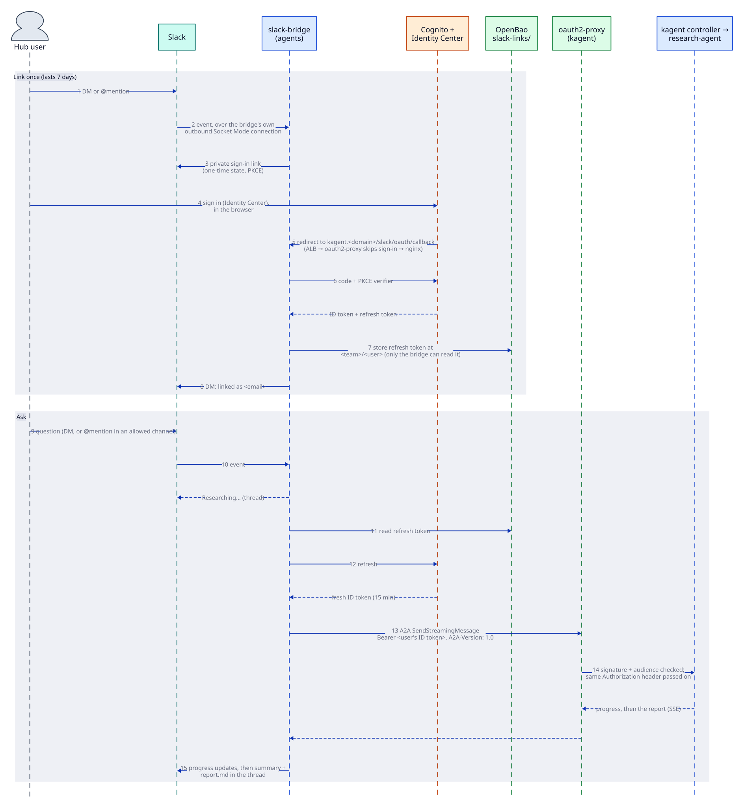

# Asking research-agent from Slack

Status: **live since 2026-11-19.** Built from this plan; see "As built" below for what changed
on the way. Decision HD-006 (`product/decisions.md`); spec H-006
(`specs/H-006-slack-bridge/spec.md`); day-to-day operation in
[operations.md](operations.md#slack-bridge). Code: `../slack-bridge`; manifests:
`deploy/agents/slack-bridge.yaml`; platform: openbao-platform D-28, D-29.

**Goal:** a user asks research-agent a question in Slack, in a channel or a DM, and gets the
report back in the same thread. The kagent UI stays a full second way in.

**Approach:** a small **Slack bridge** service in the cluster. It holds an outbound Socket
Mode connection to Slack, takes messages addressed to the bot, sends them to research-agent
over kagent's A2A endpoint **with the asking user's own Cognito token**, and posts the
report back to the Slack thread. Each Slack user links their hub account once (step 3).

Socket Mode means Slack never connects in to the hub. The ALB admits only the operator's
addresses (HD-005), and Slack's servers have no fixed set of addresses to add to that list,
so this also keeps the roadmap rule of no new Ingress.

**Effort:** about `M` (≈ 1 week).

## How it works

Linking once, then a question. The bridge opens the only connection to Slack (Socket Mode),
holds no standing access of its own to kagent, and calls research-agent with the asking
user's own short-lived ID token. Source: `docs/diagrams/slack-bridge.d2`. The deployment view
(where the bridge runs next to kagent and the agent) is research-agent's hub diagram,
`research-agent/docs/diagrams/hub.svg`, arrows S1–S4.



## As built (2026-11-19)

The plan below held. The live test turned up these differences, all fixed the same day:

| Found | Cause | Fix |
|---|---|---|
| The sign-in link never showed in a DM | Private (ephemeral) replies inside a thread show no reply count, so a link under the user's top-level message went unseen | Private replies are top-level unless the user wrote in a thread (slack-bridge `67fd043`) |
| oauth2-proxy refused the bridge's token: `email ... isn't verified` | Cognito marks Identity Center users `email_verified=false`. oauth2-proxy's `insecure-oidc-allow-unverified-email` covers its own client, not tokens accepted through `extra-jwt-issuers` | The pre-token Lambda drops `email_verified` for Identity Center users (openbao-platform D-29, layer 25) |
| kagent refused the call: `requested "0.3", served "1.0"` | The SDK's client factory sets `A2A-Version`; building the transport directly doesn't | The bridge sends `A2A-Version: 1.0`, and the test fake now requires it (slack-bridge `89133f5`) |
| A channel message got no reply | Channel messages reach the bridge only when they mention it: the app can't read channel history. Typed text that isn't picked from Slack's list isn't a mention | Documented; mentions the bridge ignores are now logged (slack-bridge `c8653b6`) |

Also confirmed live: forged and unsigned tokens get 403 at oauth2-proxy. Runs started from
Slack show under the same user in the kagent UI. With the bridge stopped, the UI works, and
Slack drops messages sent meanwhile (they aren't answered later). Evals still open:
EVAL-01 (golden set from Slack) and EVAL-04 (an unassigned user can't link).

## Decisions

| # | Question | Decision |
|---|---|---|
| 1 | How the bridge calls kagent for a Slack user | **The bridge has its own Cognito client** (option 3a). Refined by the findings below: each Slack user signs in through it once (account linking) and the bridge calls kagent with that user's own ID token, not with a claim it makes up. Report ownership and cost stay per user. |
| 2 | Where the bot answers | **Channels and DMs.** A research report is fine to post in full where it was asked. |
| 3 | What happens if Slack is down | **The kagent UI stays a full way in.** Slack is an extra entry point, never the only one: same agent, same reports, same user identity. |

## Findings (2026-11-19, kagent v1.0.0 source, tag `v1.0.0`, commit `a08cde7`)

1. **kagent 1.0 has no Slack integration, but 0.x had an example** ("kagent + Slack",
   `kagent.dev/docs/kagent/0.x/examples/slack-a2a/`, code in
   `github.com/kagent-dev/a2a-slack-template`, commit `11a870a`, 2025-08-11). It confirms the
   shape chosen here (Python, `slack_bolt`, Socket Mode, an A2A client) but is a ~200-line
   sketch, not something to deploy:
   - **Written for 0.x.** It posts to `/api/a2a/<ns>/<name>/` with `a2a-sdk` 0.3. kagent 1.0
     removed that path: A2A is now JSON-RPC at `POST /agents/<ns>/<name>` (and gRPC
     `A2AService`, which the UI uses), built on `a2a-go/v2`. research-agent already uses
     `a2a-sdk` 1.3, so the bridge uses that.
   - **No authentication.** It calls the controller through `kubectl port-forward` with no
     token, as one anonymous caller. On this hub that is refused, and would be one shared
     identity anyway (findings 2–3).
   - **One blocking call** (`send_message`, 600 s timeout) behind a `/mykagent` slash
     command, no streaming or progress, no threads or follow-ups.
   - **The whole answer in one section block.** Slack caps those at 3,000 characters, so a
     research report would be rejected.
   - **Errors posted to the channel verbatim**, which can leak internal details.
   - Its other half, a Slack MCP server the *agent* uses to post to Slack, is not wanted
     here: it would give research-agent its own outbound channel (lethal trifecta).

   Use it as a reference for the Bolt wiring and Block Kit layout, not as a base to fork.
2. **kagent can't let a service act for a user.** There is no impersonation or on-behalf-of
   mechanism (`go/core/internal/httpserver/auth`). A service-account token (audience
   `kagent-invocation`, checked by TokenReview) authenticates as *that service account*:
   principal `PrincipalID("kubernetes:<authority>", <SA UID>)`. All Slack users would share
   one identity, which is option 3b, rejected.
3. **The hub's controller trusts any JWT that reaches it.** In `trusted-proxy` mode
   (`proxy_authn.go`) it reads the bearer token *without checking its signature* and takes
   the principal `PrincipalID("trusted-proxy:" + iss, sub)`. oauth2-proxy does the check,
   and `deploy/kagent/controller-networkpolicy.yaml` lets only `kagent` and `ate-system`
   reach the controller, so nothing else can present a forged token. A bridge that
   "says which user it acts for" by writing its own token would be exactly that forgery, so
   that version of 3a is **out**.
4. **A real Cognito ID token for the user gives the same identity as the UI.** The
   principal depends only on `iss` and `sub`, not on which Cognito client issued the token
   (`aud` is not checked). A token from the bridge's own client therefore maps to the same
   principal, the same conversations and the same report prefix (spec 026) as the user's UI
   sign-in. **No kagent change is needed.**

## Steps

### 1. Record the decision (`XS`, done 2026-11-19)

- HD-006 in `product/decisions.md`; spec H-006 in `specs/H-006-slack-bridge/spec.md`.

### 2. Create the Slack app (`XS`, done by the operator)

The bot only receives mentions and DMs, so it needs no permission to read channel history.
No email permission either: account linking (step 3) replaces matching users by email.

1. Go to <https://api.slack.com/apps>, **Create New App**, **From a manifest**, pick the
   test workspace, and paste:

   ```yaml
   display_information:
     name: Research Agent
     description: Ask the hub's research-agent for a cited report
   features:
     app_home:
       home_tab_enabled: false
       messages_tab_enabled: true
       messages_tab_read_only_enabled: false
     bot_user:
       display_name: research-agent
       always_online: true
   oauth_config:
     scopes:
       bot: [app_mentions:read, chat:write, files:write, im:history]
   settings:
     event_subscriptions:
       bot_events: [app_mention, message.im]
     interactivity:
       is_enabled: false
     org_deploy_enabled: false
     socket_mode_enabled: true
     token_rotation_enabled: false
   ```

2. **Basic Information → App-Level Tokens → Generate Token and Scopes**: name it
   `socket`, add the scope `connections:write`, generate. This is `SLACK_APP_TOKEN`
   (`xapp-…`).
3. **Install App → Install to Workspace**, allow. The **Bot User OAuth Token** is
   `SLACK_BOT_TOKEN` (`xoxb-…`).
4. Create or pick a channel for research questions, run `/invite @research-agent` in it,
   and copy its channel ID (channel name → **About**, at the bottom; it starts with `C`).
   That goes in `ALLOWED_CHANNELS`, stored in OpenBao with the tokens (step 5), not in
   the manifest: this repo is public. Several channels: comma-separated.
5. With the hub up, put the tokens and the channel ID(s) in OpenBao without leaving the
   tokens in shell history:

   ```bash
   read -rs SLACK_BOT_TOKEN && read -rs SLACK_APP_TOKEN     # paste each, press Enter
   bao kv put kv/projects/slack-bridge/slack \
     SLACK_BOT_TOKEN="$SLACK_BOT_TOKEN" SLACK_APP_TOKEN="$SLACK_APP_TOKEN" \
     ALLOWED_CHANNELS=C0123456789
   unset SLACK_BOT_TOKEN SLACK_APP_TOKEN
   ```

   ESO syncs it into the `slack-bridge` Secret within an hour; to pick it up at once:
   `kubectl -n agents annotate externalsecret slack-bridge force-sync=$(date +%s) --overwrite`,
   then `kubectl -n agents rollout restart deploy/slack-bridge`.

   Never paste the tokens into chat, a file in a repo, or a ticket. If one leaks, regenerate
   it on the same page (app-level token) or **Reinstall** (bot token), then repeat step 5.

In channels, every question, follow-ups included, needs an `@research-agent` mention: the bot
gets mention events only, which keeps it from reading anything else. In a DM no mention is
needed.

### 3. Link Slack users to hub users (`S`)

- **Cognito client for the bridge** (openbao-platform, Cognito layer): a confidential app
  client with the authorization-code flow, PKCE, scopes `openid email profile`, the same
  Identity Center provider as the `kagent` client, and a callback on the hub's kagent host
  (for example `https://kagent.edwardpius.me/slack/callback`, routed to the bridge). The
  callback is reached by the user's browser, so it stays behind the ALB's address allowlist
  like the rest of the hub.
- **First request from a Slack user:** the bot replies with a private message only that user
  can see: "Connect your hub account", with a link to Cognito's sign-in. The user signs in
  through Identity Center once. Users not assigned to the app can't sign in, as in Phase 1.
- **The bridge stores** the Slack user ID → refresh token mapping in OpenBao (a per-bridge
  path, never in Slack or in the pod's disk) and gets a fresh ID token for each request.
  The ID token lives 15 minutes, longer than a research run.
- **Refresh-token lifetime** sets how long a link lasts and how long a user removed from
  Identity Center keeps Slack access. It is 7 days (decided 2026-11-19); users sign in
  again when it ends. Add a `disconnect` command that deletes the user's token.
- **How the bridge reaches the controller:** through oauth2-proxy, not directly, so the
  token's signature is checked as it is for the UI. That needs oauth2-proxy to accept bearer
  tokens from the bridge's client (`skip-jwt-bearer-tokens`, `extra-jwt-issuers=<Cognito
  issuer>=<bridge client ID>`, layer 45) and to pass the `Authorization` header on. Confirm
  on the cluster that the header reaches the controller unchanged. The fallback is to admit
  the bridge pod in `controller-networkpolicy.yaml`, which makes the bridge part of the
  trusted path; avoid it if the proxy route works.

### 4. Build the bridge (`S`)

- Python, `slack_bolt` in Socket Mode, `a2a-sdk` 1.x calling `POST /agents/kagent/research-agent`
  (JSON-RPC, streaming), and the OAuth callback (step 3). The 0.x template (finding 1)
  shows the Bolt wiring.
- Triggers: mentions in channels and DMs (decision 2), not a slash command, so replies can
  live in threads.
- Slack wants each event acknowledged within 3 seconds; a research run takes 1–3 minutes.
  The bridge acknowledges at once, posts a "researching…" reply, then follows the A2A task
  (streaming or polling) and updates that reply with progress.
- One Slack thread is one A2A conversation, so follow-up questions in the thread continue
  the same research context.
- Answer only messages that mention the bot in a channel, or any message in a DM. Ignore
  bot messages, including its own. One running job per user at a time. Show errors and
  timeouts in the thread.

### 5. Post the report (`XS`)

- Slack has its own markdown dialect (mrkdwn) and size limits: about 3,000 characters per
  section block and about 40,000 per message.
- Post a short summary with the key citations in the thread, and attach the full `.md` with
  `files.uploadV2`. Per decision 2, the full report goes in channels as well as DMs.
- Also link the report's `/reports/` download, so the user finds it in the hub too.

### 6. Deploy and network it (`S`)

- Image built like the other agents: trixie base, non-root user, pip removed, Trivy scan.
  Add `scripts/release-slack-bridge.sh`, and `deploy/agents/slack-bridge.yaml` (synced by the
  existing `ai-hub-agents` Argo CD app).
- A normal Deployment in `agents`, not a kagent actor, because it must stay connected.
- Network:
  - outbound to `slack.com` and `wss-primary.slack.com` through the NAT, and to Cognito's
    token endpoint;
  - to the kagent oauth2-proxy Service (step 3);
  - inbound only the OAuth callback route on the kagent host;
  - nothing else.
- openbao-platform changes: the bridge's Cognito client; oauth2-proxy's bearer-token
  settings and the callback route (layer 45). These are local commits on `agent-substrate`,
  pushed only when you say so.
- Add it to `stack.sh up`/`down` and to `docs/operations.md`, and a Phase 5 item in
  `product/roadmap.md`.

### 7. Safety and cost (`XS`)

- Slack messages are untrusted input, and Slack is also a way for output to leave the hub.
  Record both in research-agent's lethal-trifecta declaration.
- The stored refresh tokens are user credentials: OpenBao only, a policy that lets only the
  bridge read them, never logged.
- Answer only in allowed channels and DMs.
- Per-user rate limit and daily cost cap (already a Phase 4 idea in the roadmap).

### 8. Observability and testing (`S`)

- OTel spans from the bridge, linked to the research-agent trace in Phoenix, with the Slack
  user and channel recorded so cost is tracked per user.
- Unit tests with a fake Slack, a fake Cognito and a fake A2A server; an end-to-end run in a
  test workspace.

## Acceptance

- Golden-set questions asked through Slack meet research-agent's bar: median under
  3 minutes, cost under $0.50.
- A report asked for in Slack appears for the same user in the kagent UI and downloads.
- A Slack user whose hub account isn't assigned in Identity Center can't link, and gets no
  answer.
- A token not signed by Cognito, sent by the bridge, is refused (oauth2-proxy checks it).
- With the bridge stopped (standing in for a Slack outage), the same user still asks
  research-agent in the kagent UI and sees their earlier reports, including the ones asked
  for in Slack.
